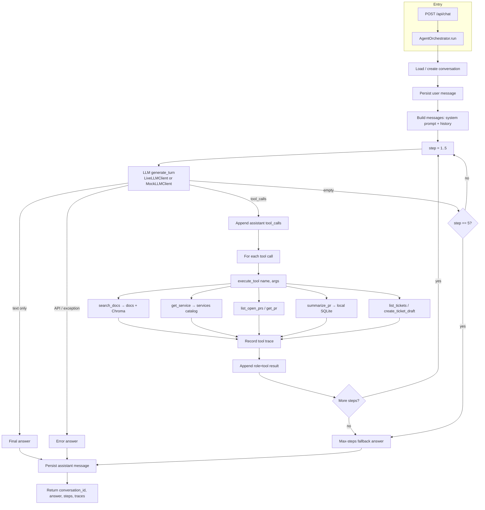

# PulseOps agent graph

There is no compiled graph (no LangGraph). Control flow is a ReAct-style loop in `AgentOrchestrator.run()`, capped at **5 LLM rounds** (`max_agent_steps = 5`).

## Control flow

## What steps 1–5 are

They are not five named pipeline stages. Each **step** is one LLM round: call the model → run any tool calls → loop, or stop if the model returns a final answer.

| Step | Typical use |
|------|-------------|
| 1 | First LLM call on the user message. Usually one or more tools. |
| 2 | LLM sees tool results. May call another tool or write the answer. |
| 3–4 | Extra rounds if the task still needs more tools. |
| 5 | Last allowed round. If the model still only calls tools, the orchestrator returns the max-steps fallback message. |

Most requests finish in 1–2 steps. Five is a ceiling. `steps_taken` in the API response is how many rounds actually ran.

**Example:** “Who owns checkout-api and draft a P3 runbook ticket?”

1. `get_service(checkout-api)`
2. `create_ticket_draft(...)` using the owner/team from step 1
3. Final written answer (no more tools)

## Stop conditions

1. LLM returns content and no tool calls → done
2. LLM / API throws → error string
3. Five steps with no final content → max-steps message

Policy refusal is not a graph node. The system prompt (and the mock client) tell the model to answer with “cannot” and skip tools.

Tools never call each other. After every tool batch, control returns to the LLM for the next step.
